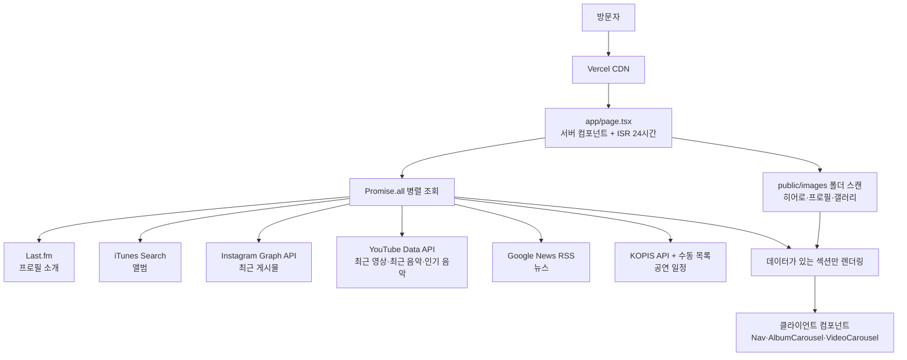

# 홍이삭 팬 페이지 운영·관리 가이드

> 이 문서는 `isaac-hong-fan` 웹사이트를 관리하는 사람 또는 에이전트를 위한 기술·콘텐츠 운영 기준서다.  
> 기준일: **2026-11-13 (Asia/Seoul)**  
> 운영 URL: <https://isaac-hong-fan.vercel.app/>  
> GitHub: <https://github.com/TaeyeonKim92/isaac-hong-fan>  
> Vercel 프로젝트: <https://vercel.com/taeyeonkim92s-projects/isaac-hong-fan>

## 1. 한눈에 보는 사이트

홍이삭의 음악, 영상, 공연, 뉴스와 주요 활동을 한 페이지에서 보여주는 비공식 팬 페이지다. 정적인 소개 페이지처럼 보이지만, 실제로는 여러 외부 API와 RSS를 서버에서 동시에 조회한 뒤 데이터가 있는 섹션만 렌더링한다.

- 프레임워크: Next.js 14 App Router + React 18 + TypeScript
- 스타일: Tailwind CSS 3 + CSS 커스텀 속성
- 호스팅: Vercel
- 기본 브랜치: `main`
- 페이지 구성: 단일 홈 페이지 + 진단용 API 라우트 2개
- 갱신 방식: ISR(Incremental Static Regeneration), `revalidate = 86400`으로 최대 24시간 단위 재생성
- 핵심 특징: 외부 데이터 소스에 장애가 나도 전체 페이지를 실패시키지 않고 해당 섹션만 숨김

## 2. 전체 구조



### 요청 처리 순서

1. Vercel이 캐시된 페이지를 반환한다.
2. 재검증 시간이 지나면 Next.js가 서버에서 홈 페이지를 다시 생성한다.
3. `app/page.tsx`가 8개 데이터 함수를 `Promise.all`로 병렬 호출한다.
4. 각 `lib/*.ts` 모듈이 외부 API 응답을 화면용 데이터로 변환한다.
5. API 키 누락, 요청 실패 또는 빈 결과가 발생하면 대부분 `null`이나 빈 배열을 반환한다.
6. 홈 페이지는 데이터가 있는 섹션만 조건부로 출력한다.

따라서 “페이지는 정상인데 특정 섹션만 사라짐”은 현재 구조에서 예상 가능한 장애 형태다.

## 3. 디렉터리와 파일 역할

```text
app/
├─ layout.tsx                   전역 레이아웃, 폰트, 메타데이터, 상단 Nav
├─ page.tsx                     홈 페이지 조립, 외부 데이터 병렬 조회, ISR 설정
├─ globals.css                  색상 토큰, 공통 컴포넌트 스타일, 애니메이션
├─ components/
│  ├─ Nav.tsx                  고정형 상단 내비게이션
│  ├─ AlbumCarousel.tsx        앨범 8개 단위 페이지 전환
│  └─ VideoCarousel.tsx        영상 6개 단위 페이지 전환
└─ api/
   ├─ test-lastfm/route.ts      Last.fm 연결 진단 API
   └─ test-spotify/route.ts     Spotify 연결 진단 API

lib/
├─ history.ts                   수동 관리하는 주요 활동 타임라인
├─ instagram.ts                 Instagram Business Discovery 조회
├─ itunes.ts                    앨범과 최신 정규/EP 트랙 조회·필터
├─ kopis.ts                     공연 검색, 출연진 보조 검색, 예매 링크 보정
├─ lastfm.ts                    프로필 소개와 진단용 인기 트랙 함수
├─ news.ts                      Google News RSS 파싱
├─ spotify.ts                   Spotify 유틸리티; 현재 홈 페이지에서는 미사용
└─ youtube.ts                   두 YouTube 채널의 최신 업로드 통합

public/images/
├─ hero/                        첫 번째 이미지가 히어로 배경
├─ profile/                     첫 번째 이미지가 프로필 사진
├─ gallery/                     모든 이미지가 갤러리 그리드에 표시
└─ logo/                        상단·히어로·푸터 로고
```

## 4. 프런트엔드 도구와 구현 방식

| 영역 | 도구/기술 | 현재 역할 |
|---|---|---|
| 프레임워크 | Next.js `14.2.29` | App Router, 서버 컴포넌트, 이미지 최적화, ISR |
| UI 런타임 | React `18` | 내비게이션 스크롤 상태와 캐러셀 페이지 상태 |
| 언어 | TypeScript 5 | 데이터 인터페이스와 컴포넌트 타입 |
| 스타일링 | Tailwind CSS 3 | 반응형 레이아웃, 간격, 타이포그래피, 상태 스타일 |
| 전역 디자인 토큰 | CSS variables | 배경·텍스트·테두리·강조 색상 통일 |
| 폰트 | `next/font/google` | Inter와 Playfair Display 빌드 최적화 |
| 이미지 | `next/image` + 일반 `` | 앨범·영상·로컬 사진 최적화; Instagram은 일반 이미지 태그 사용 |
| 외부 데이터 | 표준 `fetch` | 별도 클라이언트 SDK 없이 서버에서 API 호출 |
| 배포 | Vercel | Next.js 빌드, CDN 캐시, ISR 실행 |

### 서버/클라이언트 경계

- `app/page.tsx`는 서버 컴포넌트다. API 키가 브라우저 번들로 전달되지 않는다.
- `Nav`, `AlbumCarousel`, `VideoCarousel`만 `'use client'`를 사용한다.
- 브라우저 측 상호작용은 스크롤 상태와 캐러셀 페이지 전환 정도로 제한되어 있어 클라이언트 번들이 비교적 작다.
- 실제 프로덕션 빌드 기준 홈 페이지 크기는 약 6.64 kB, 첫 로드 JS는 약 93.8 kB였다.

## 5. UI와 디자인 특징

### 시각 언어

- 따뜻한 베이지 배경 `#f7f2ea`와 짙은 갈색 텍스트 `#261a0e`를 중심으로 한 에디토리얼 스타일이다.
- 강조색은 테라코타 계열 `#9b4f2a`다.
- Inter는 본문과 UI에, Playfair Display는 일부 제목·숫자에 사용한다.
- 대문자, 넓은 자간, 가는 테두리, 큰 여백으로 차분한 음악가 포트폴리오 분위기를 만든다.
- 히어로는 화면 전체 높이를 사용하며, 배경 사진 위에 약 72% 불투명한 베이지 오버레이를 씌운다.
- 카드보다 선과 여백으로 섹션을 구분하고, 이미지에는 둥근 모서리와 hover 확대 효과를 사용한다.

### 레이아웃과 반응형

- 콘텐츠 최대 폭은 대부분 `max-w-6xl`이다.
- 데스크톱 상단 메뉴: Albums / Gallery / History / 중앙 로고 / Tour / News.
- 앨범 데이터가 비어도 `#albums` 앵커와 섹션을 유지하고 YouTube Music·Spotify·Melon 안내 링크를 표시한다.
- `md` 미만에서는 텍스트 메뉴 전체가 숨고 중앙 로고만 남는다. 모바일 대체 메뉴나 햄버거 버튼은 없다.
- 앨범: 모바일 2열, 데스크톱 4열, 한 페이지 최대 8개.
- 공식 YouTube 음악은 `최근 음악`과 `인기 음악`의 2열로 표시한다.
- 영상: 모바일 1열, `md` 이상 3열, 한 페이지 최대 6개.
- Instagram: 모바일 1열, `sm` 2열, `lg` 3열.
- 갤러리: 2열 → 3열 → 4열.
- 히스토리는 최소 폭 1120px의 가로 타임라인이라 작은 화면에서 가로 스크롤한다.

### 상호작용

- 상단 내비게이션은 80px 이상 스크롤하면 반투명 배경, 블러와 하단 선이 생긴다.
- 히어로의 주 버튼은 공식 Instagram, 공식 YouTube, YouTube Music, Spotify, Melon으로 구성한다.
- Spotify와 Melon은 검색 결과가 아닌 홍이삭 아티스트 상세 페이지로 직접 연결한다.
- Vlog YouTube와 개인 Instagram은 공식 채널과 구분되는 보조 텍스트 링크로 표시한다.
- 음악 항목은 YouTube Music의 해당 곡으로 직접 연결한다.
- 모든 외부 콘텐츠 링크는 새 탭에서 열린다.
- 앨범과 영상은 페이지 점과 좌우 화살표로 이동한다.
- 영상 썸네일은 hover 시 플레이 아이콘 오버레이가 나타난다.
- 갤러리와 Instagram 이미지는 hover 시 천천히 확대된다.

## 6. 섹션별 데이터와 갱신 기준

| 화면 섹션 | 소스 | 코드 위치 | 자동 갱신 | 수동 작업이 필요한 경우 |
|---|---|---|---|---|
| 히어로 | `public/images/hero` | `app/page.tsx` | 배포 시 반영 | 배경 사진 교체·추가 |
| 프로필 | 로컬 이미지 + Last.fm bio | `app/page.tsx`, `lib/lastfm.ts` | bio는 ISR | 프로필 사진 교체, 소개 문구 품질 보정 |
| 앨범 | iTunes Search API | `lib/itunes.ts` | ISR | 검색 누락, 아티스트명 변경, 필터 오판 |
| 최근·인기 음악 | YouTube Data API v3 | `lib/youtube.ts` | ISR | API 키·할당량 문제, 공식 채널 또는 음악 카테고리 변경 |
| 갤러리 | `public/images/gallery` | `app/page.tsx` | 배포 시 반영 | 사진 추가·삭제·순서 변경 |
| Instagram | Instagram Graph API | `lib/instagram.ts` | ISR | 액세스 토큰 만료, 계정명 변경, API 버전 변경 |
| 최신 영상 | YouTube Data API v3 | `lib/youtube.ts` | ISR | API 키·할당량 문제, 채널 handle 변경 |
| 히스토리 | 코드 내 배열 | `lib/history.ts` | 자동 아님 | 새 앨범, 수상, 방송, 단독 공연 등 주요 이력 발생 |
| 공연 일정 | KOPIS + 코드 내 수동 목록 | `lib/kopis.ts` | ISR | KOPIS 누락 공연, 잘못된 예매 링크, 수동 일정 만료 |
| 뉴스 | Google News RSS | `lib/news.ts` | ISR | 검색 품질 저하, HTML 엔티티 노출, 무관 기사 증가 |

### 로컬 이미지 규칙

- 허용 확장자: `.jpg`, `.jpeg`, `.png`, `.webp`
- 파일명 오름차순으로 정렬한다.
- `hero`와 `profile`은 정렬 후 첫 파일 하나만 사용한다.
- `gallery`는 모든 파일을 사용한다.
- 원하는 순서를 확실히 하려면 `01-...`, `02-...` 형식의 파일명을 권장한다.
- GIF와 AVIF는 현재 폴더 스캔 대상이 아니다.

## 7. 외부 연동 상세

### Last.fm

- 검색 아티스트는 `Isaac Hong`으로 고정되어 있다.
- 홈에서는 프로필 소개에만 사용한다. 인기 트랙 자동 목록은 YouTube 공식 데이터로 대체했다.
- `LASTFM_API_KEY`가 필요하다.
- 현재 키는 프로덕션에서 동작하지만 `.env.local.example`에는 항목이 빠져 있다.

### iTunes Search API

- API 키가 필요 없다.
- 검색 결과의 `artistName`이 정확히 `홍이삭`인 앨범만 허용한다.
- 특정 싱글 3개를 이름으로 제외한다.
- 2026-11-13 확인 당시 iTunes 검색 결과가 비어 있어 라이브 사이트는 앨범 대신 공식 음원 플랫폼 안내를 표시한다.

### YouTube Data API v3

- `@pngisac-video`, `@pngisacofficial` 두 채널의 업로드 재생목록을 합친다.
- 업로드 날짜순으로 정렬하고 최대 50개를 홈으로 전달한다.
- 별도 통계 요청으로 조회수를 붙인다.
- 공식 아티스트 채널의 `/releases` 탭에서 `OLAK5uy_...` 발매 플레이리스트 ID만 수집한다.
- 각 발매 플레이리스트의 실제 트랙과 조회수는 YouTube Data API로 조회한다. 일반 자체 콘텐츠 영상은 포함하지 않는다.
- `최근 음악`은 발매 트랙의 공개일순, `인기 음악`은 조회수순이다. YouTube Music 자체 차트는 아니다.
- Releases 탭 구조를 읽지 못하면 일반 업로드로 대체하지 않고 음악 섹션을 숨긴다.
- 배포 전 `npm run check:youtube-releases`로 Releases 구조와 발매 플레이리스트 추출을 검증한다.
- YouTube Data API 요청에 `hl=ko`를 지정해 업로더가 등록한 공식 한국어 현지화 제목을 우선한다. 값이 없으면 원문 제목을 유지한다.
- 개별 음악 항목은 무료 계정에서도 재생 가능한 `youtube.com/watch?v=...`로 연결하고, 상단 아티스트 버튼만 YouTube Music으로 연결한다.
- `YOUTUBE_API_KEY`와 일일 API 할당량이 필요하다.

### Instagram Graph API

- `hongisaac_official`, `pngisac` 계정을 Business Discovery로 조회한다.
- 계정당 3개를 가져와 시간순으로 합친다.
- 필요한 값: `INSTAGRAM_ACCESS_TOKEN`, `INSTAGRAM_BUSINESS_ACCOUNT_ID`.
- API 버전 기본값은 `v23.0`이다.
- 토큰 또는 Business/Creator 계정 연결이 없으면 섹션 전체가 숨는다.

### KOPIS

- `KOPIS_API_KEY`가 없으면 코드의 `MANUAL_PERFORMANCES`만 사용한다.
- 공연명 직접 검색 뒤, 대중음악 목록 일부를 추가로 훑으며 출연진에 홍이삭이 있는지도 검사한다.
- KOPIS가 실제 예매 상품 URL을 제공하면 이를 우선하고, 직접 링크가 없을 때만 티켓링크·YES24·인터파크 검색 URL로 보정한다.
- 여러 회차가 있는 공연은 `schedule` 배열을 사용해 한 카드 안에 회차별 날짜와 시간을 표시할 수 있다.
- 수동 공연은 종료일이 지난 뒤 자동으로 목록에서 빠지지만, 코드에서는 그대로 남는다.

### 공연 업데이트 하네스

- 사람이 확인한 공연 기준 데이터는 `data/performances.json`에서 관리한다.
- 에이전트가 따라야 하는 조사·수정·검증 규칙은 `AGENTS.md`에 있다.
- 상세 작업 절차와 데이터 계약은 `docs/PERFORMANCE_UPDATE_RUNBOOK.md`에 있다.
- `npm run check:performances`는 회차 누락, 날짜 범위, 중복 회차, 검색 결과 URL, 직접 예매 링크 상태와 아티스트 일치 여부를 검사한다.
- 공식 상품이 아직 열리지 않았으면 검색 URL을 넣지 않고 `bookingStatus: upcoming`, 빈 `bookingUrl`, 공식 `sourceUrl`로 보류한다.

### Google News RSS

- `홍이삭`으로 Google News 한국어 RSS를 검색한다.
- 최신순 6개만 표시한다.
- 현재 정규식 기반의 간단한 XML 파서를 사용한다.
- 일부 기사 설명에서 HTML이 엔티티 형태로 남아 화면에 `<a href=...` 조각이 노출될 수 있다.

### Spotify

- `lib/spotify.ts`와 `/api/test-spotify`는 남아 있지만 홈 페이지는 Spotify 데이터를 사용하지 않는다.
- 히어로의 Spotify 버튼은 홍이삭 아티스트 상세 페이지로 연결되는 정적 링크다.
- 현재 프로덕션 `/api/test-spotify` 응답으로 보아 Spotify 환경변수는 설정되지 않았다.
- 홈 기능에 필요하지 않다면 모듈과 공개 진단 라우트를 제거할 수 있다.

## 8. 환경변수

| 변수 | 필수도 | 용도 | 미설정 시 |
|---|---|---|---|
| `LASTFM_API_KEY` | 프로필 사용 시 필요 | 프로필 소개 | 프로필 bio가 사라짐 |
| `YOUTUBE_API_KEY` | 중요 | 최신 영상 | 영상 섹션이 사라짐 |
| `KOPIS_API_KEY` | 선택 | 자동 공연 검색 | 수동 공연만 표시 |
| `KOPIS_CAST_SCAN_PAGES` | 선택 | 출연진 보조 검색 범위 | 기본 2페이지 |
| `KOPIS_POPULAR_MUSIC_GENRE_CODE` | 선택 | KOPIS 대중음악 장르 | 기본 `CCCD` |
| `INSTAGRAM_ACCESS_TOKEN` | Instagram 사용 시 필수 | Graph API 인증 | Instagram 섹션이 사라짐 |
| `INSTAGRAM_BUSINESS_ACCOUNT_ID` | Instagram 사용 시 필수 | Business Discovery 기준 계정 | Instagram 섹션이 사라짐 |
| `INSTAGRAM_GRAPH_API_VERSION` | 선택 | Graph API 버전 | 기본 `v23.0` |
| `SPOTIFY_CLIENT_ID` | 홈에는 불필요 | 미사용 Spotify 모듈·진단 API | 진단 API가 환경변수 없음 응답 |
| `SPOTIFY_CLIENT_SECRET` | 홈에는 불필요 | 미사용 Spotify 모듈·진단 API | 진단 API가 환경변수 없음 응답 |

운영 원칙:

- 실제 키와 토큰은 `.env.local`, Git, 문서, 이슈에 기록하지 않는다.
- 로컬에서는 `.env.local`, 프로덕션에서는 Vercel Environment Variables로 관리한다.
- 새 변수를 추가할 때 `.env.local.example`과 이 문서를 함께 갱신한다.
- 토큰 교체 뒤에는 Vercel 재배포 또는 재검증을 실행하고 실제 섹션 노출을 확인한다.

## 9. 배포와 캐시

### 현재 확인된 배포 특성

- 운영 URL은 HTTP 200을 반환한다.
- 응답 헤더는 `Server: Vercel`, `X-Powered-By: Next.js`, `X-Vercel-Cache: HIT`를 보여 주었다.
- 저장소에는 `vercel.json`이 없다. 빌드 명령, 프로덕션 브랜치, 환경변수, 도메인 설정은 Vercel 프로젝트 설정에 의존한다.
- 제공된 구조는 GitHub `main` → Vercel 프로젝트 → 운영 URL 흐름이다.
- 인증된 Vercel 설정 화면은 이번 점검에서 확인하지 않았으므로 실제 Git 연결과 Production Branch는 Vercel의 **Settings → Git**에서 최종 확인해야 한다.

### 권장 배포 흐름

1. 작업 전 `git status`로 기존 변경사항을 확인한다.
2. 로컬 브랜치에서 수정한다.
3. `npm ci`와 `npm run build`를 실행한다.
4. 로컬 화면에서 데스크톱과 모바일을 확인한다.
5. GitHub에 push한 뒤 Vercel Preview Deployment를 확인한다.
6. `main` 병합 또는 push 후 Production Deployment 성공 여부를 확인한다.
7. 운영 URL에서 변경 내용, API 데이터, 외부 링크, 모바일 레이아웃을 재확인한다.

### ISR 주의사항

- `revalidate = 86400`은 정확히 매일 정해진 시각에 실행되는 크론 작업이 아니다.
- 24시간이 지난 뒤 들어온 요청이 재검증을 유발하는 방식이다.
- 외부 API에 새 데이터가 생겨도 최대 하루 정도 늦게 보일 수 있다.
- 데이터가 급한 경우 재배포하거나 Vercel 캐시 재검증 수단을 사용해야 한다.
- 코드, 로컬 이미지, 의존성 변경은 새 배포가 필요하다.

## 10. 언제 무엇을 업데이트해야 하는가

### 콘텐츠 이벤트가 발생했을 때

- 새 단독 공연·수상·앨범·주요 방송: `lib/history.ts` 검토
- KOPIS에 없는 새 공연: `MANUAL_PERFORMANCES`에 임시 추가
- 공연 종료: 수동 목록의 잔존 데이터 정리
- 공식 YouTube 채널 변경: `YOUTUBE_CHANNEL_HANDLES` 수정
- Instagram 계정명 변경: `INSTAGRAM_USERNAMES` 수정
- 새 대표 사진: `public/images/hero` 또는 `profile` 교체
- 팬 갤러리 추가: `public/images/gallery`에 번호가 붙은 파일 추가

### 외부 서비스가 바뀌었을 때

- Instagram Graph API 버전 만료 공지: 버전과 응답 필드 검증
- YouTube API 할당량 초과: 요청 수와 채널 조회 방식을 최적화
- KOPIS XML 구조 또는 장르 코드 변경: 파서와 검색 파라미터 갱신
- iTunes가 아티스트를 찾지 못함: Spotify, MusicBrainz, 수동 카탈로그 등 대체 소스 검토
- Google News RSS 형식 변경: 정규식 파서 대신 XML 파서 도입 검토

### 기술 부채 점검 시점

- 월 1회: `npm outdated`, `npm audit`, 외부 링크, API 키 만료 확인
- 분기 1회: 모바일·데스크톱 접근성, Core Web Vitals, 이미지 용량 점검
- 주요 프레임워크 보안 공지 직후: Next.js와 React 업데이트 우선 검토
- Vercel 배포 실패 시: Build Logs와 Environment Variables부터 확인

## 11. 장애 진단 순서

### 전체 사이트가 열리지 않음

1. 운영 URL HTTP 상태 확인
2. Vercel Production Deployment 상태 확인
3. 최근 커밋의 빌드 로그 확인
4. `npm ci && npm run build`로 로컬 재현
5. Next.js 또는 Vercel 장애 공지 확인

### 특정 섹션만 사라짐

1. 해당 섹션이 조건부 렌더링인지 확인
2. 관련 환경변수가 Vercel Production에 설정됐는지 확인
3. 외부 API 응답과 할당량 확인
4. API가 빈 배열을 정상 응답으로 돌려주는지 확인
5. 마지막 ISR 재검증 시각을 고려해 재배포 후 확인

### 최신 정보가 안 보임

1. 24시간 ISR 지연 가능성 확인
2. 외부 원본에 실제로 데이터가 등록됐는지 확인
3. 코드의 고정 필터가 새 콘텐츠를 제외하는지 확인
4. 재배포 후 운영 URL을 다시 확인

### 이미지가 안 보임

1. 로컬 파일 확장자와 경로 확인
2. 파일명 정렬로 원하는 파일이 첫 번째인지 확인
3. 외부 이미지 도메인이 `next.config.mjs`에 허용됐는지 확인
4. Instagram 미디어 URL이 만료됐는지 확인

## 12. 현재 라이브 상태 스냅샷

2026-11-13 기준 실제 운영 페이지에서 확인된 상태다.

### 노출 중

- 히어로와 플랫폼 링크
- YouTube 공식 채널 기반 최근 음악·인기 음악
- YouTube 최신 영상
- 주요 활동과 단독 공연 타임라인
- KOPIS 공연 일정
- Google News 기사

### 미노출

- 프로필: `public/images/profile`에 실제 이미지 없음
- 앨범: iTunes 검색 결과가 비어 있어 공식 음원 플랫폼 안내를 표시
- 갤러리: `public/images/gallery`에 실제 이미지 없음
- Instagram: 데이터가 비었거나 환경변수/토큰 조건을 충족하지 못한 상태로 추정

### 라이브 데이터 예시

- 최신 영상은 두 채널의 2026년 11월 업로드를 정상적으로 통합했다.
- 공연 일정에는 2026년 12월 소극장 콘서트가 표시됐다.
- 뉴스는 2026년 11월 기사 6개를 표시했다.
- Last.fm 데이터는 동작하며 `/api/test-lastfm`에서도 정상 응답을 확인했다.

## 13. 발견된 개선 과제

### 우선순위 P0 — 보안

1. **Next.js 보안 업데이트**
   - 현재 `next@14.2.29`는 설치 시 보안 취약 버전 경고가 발생한다.
   - `npm audit` 결과 전체 18건, 프로덕션 의존성 4건이며 Next.js가 critical로 분류됐다.
   - 최신 메이저로 즉시 올리기보다 공식 마이그레이션 가이드를 따라 별도 브랜치에서 빌드·화면·ISR을 검증한 뒤 배포한다.

2. **공개 진단 API 정리**
   - `/api/test-lastfm`, `/api/test-spotify`가 누구에게나 공개되어 있다.
   - 키 자체는 반환하지 않지만 외부 API 호출과 오류 정보를 노출하고 할당량을 소비할 수 있다.
   - 운영 환경에서는 제거하거나 관리자 인증/개발 환경 제한을 적용한다.

### 우선순위 P1 — 운영 안정성

1. `.env.local.example`에 `LASTFM_API_KEY`를 추가한다.
2. README를 현재 데이터 소스와 환경변수에 맞게 고친다.
3. iTunes 결과가 비어도 앨범을 보여 줄 수 있는 대체 데이터 소스를 마련한다.
4. 외부 API 오류를 모두 조용히 삼키지 말고 Vercel Logs에서 원인을 식별할 수 있는 구조화 로그를 남긴다.
5. 환경변수와 API별 상태를 키 노출 없이 확인하는 내부 health check를 설계한다.

### 우선순위 P2 — UI·접근성

1. 모바일 내비게이션 또는 간단한 섹션 메뉴를 추가한다.
2. 내비게이션의 `Gallery`가 `#videos`를 가리키는 명칭 불일치를 수정한다.
3. 데이터가 없어 `#albums` 섹션이 사라질 때 Albums 링크가 무효가 되는 문제를 처리한다.
4. 캐러셀의 화살표와 페이지 점에 `aria-label`을 추가한다.
5. 앨범 수가 8의 배수가 아닐 때 마지막 페이지가 앞 앨범을 반복 표시하는 로직을 검토한다.
6. 히스토리 타임라인의 모바일 가로 스크롤 사용성을 보완한다.
7. Google News snippet의 HTML 엔티티와 태그 조각을 정리한다.

### 우선순위 P3 — 유지보수

1. 사용하지 않는 `rss-parser` 의존성과 Spotify 모듈의 필요성을 재검토한다.
2. `any` 타입이 많은 외부 API 응답에 최소 타입 또는 런타임 검증을 추가한다.
3. 단위 테스트가 없으므로 필터·XML/RSS 파서·날짜 처리 테스트를 추가한다.
4. 갤러리 이미지에 실제 내용 기반의 대체 텍스트를 제공할 수 있도록 메타데이터 구조를 검토한다.

## 14. 관리 에이전트 작업 원칙

### 작업 전

- 요청이 콘텐츠 변경인지, 데이터 연동 수정인지, UI 변경인지 먼저 분류한다.
- `git status`와 최근 커밋을 확인하고 사용자의 기존 변경을 덮어쓰지 않는다.
- 외부 API 키, 토큰, Vercel 환경변수 값은 출력하거나 커밋하지 않는다.
- 라이브 데이터는 바뀔 수 있으므로 수정 전에 원본 서비스와 운영 페이지를 다시 확인한다.

### 작업 중

- 콘텐츠 상수를 바꾸면 날짜·종료일·링크를 원본과 대조한다.
- 데이터 소스 하나의 실패가 전체 페이지 실패로 번지지 않게 유지한다.
- 새 외부 이미지 도메인을 추가하면 `next.config.mjs`도 함께 검토한다.
- 새 섹션은 데이터가 없을 때의 빈 상태와 모바일 배치를 함께 설계한다.
- API 호출 수와 YouTube·Instagram·KOPIS 할당량을 고려한다.

### 완료 조건

- `npm run build` 성공
- TypeScript·Next.js 빌드 검사 통과
- 변경한 섹션의 데이터 있음/없음 상태 모두 확인
- 390px 안팎 모바일과 1440px 데스크톱 확인
- 외부 링크의 대상·새 탭·보안 속성 확인
- Preview Deployment 확인 후 Production 반영
- 관련 README, 환경변수 예시, 이 운영 문서를 함께 갱신

## 15. 로컬 실행과 검증 명령

```bash
npm ci
cp .env.local.example .env.local
npm run dev
```

프로덕션 빌드 검증:

```bash
npm run build
npm run start
```

의존성 상태 점검:

```bash
npm outdated
npm audit
```

주의: 현재 `npm run lint`는 `next lint` 스크립트를 사용한다. 프레임워크 업그레이드 시 독립 ESLint 설정과 명령으로 마이그레이션해야 할 수 있다.

## 16. 빠른 운영 체크리스트

### 매주 또는 콘텐츠 변경 후

- [ ] 운영 URL이 정상 응답하는가?
- [ ] 최신 영상·공연·뉴스 날짜가 합리적인가?
- [ ] 무관한 인물의 앨범이나 뉴스가 섞이지 않았는가?
- [ ] 모든 외부 링크가 올바른 대상으로 열리는가?
- [ ] 모바일에서 히어로 버튼과 타임라인을 사용할 수 있는가?

### 배포 전

- [ ] 비밀값이 Git 변경사항에 포함되지 않았는가?
- [ ] `npm ci`가 성공하는가?
- [ ] `npm run build`가 성공하는가?
- [ ] Preview에서 데이터가 있는 상태와 없는 상태를 확인했는가?
- [ ] 새 환경변수가 Vercel의 올바른 환경에 추가됐는가?

### 배포 후

- [ ] Vercel Production Deployment가 성공했는가?
- [ ] 운영 URL에서 새 버전이 보이는가?
- [ ] ISR/캐시 때문에 이전 데이터가 남은 것은 아닌가?
- [ ] Vercel Logs에 외부 API 오류가 급증하지 않았는가?
- [ ] 변경된 API의 할당량과 토큰 만료 상태가 정상인가?

---

이 문서는 코드 구조가 바뀌거나 데이터 소스·환경변수·배포 방식이 바뀔 때 함께 업데이트한다. 단순 콘텐츠 추가라도 수동 관리 지점이나 장애 진단 방식이 달라졌다면 관련 항목을 갱신해야 한다.
